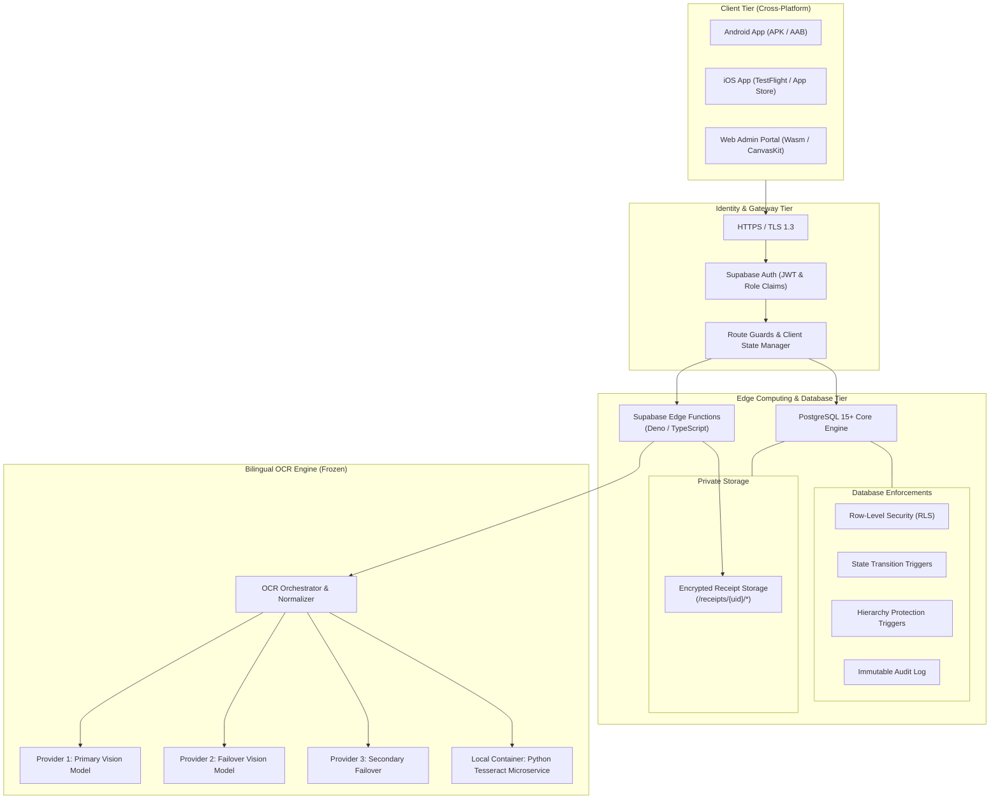
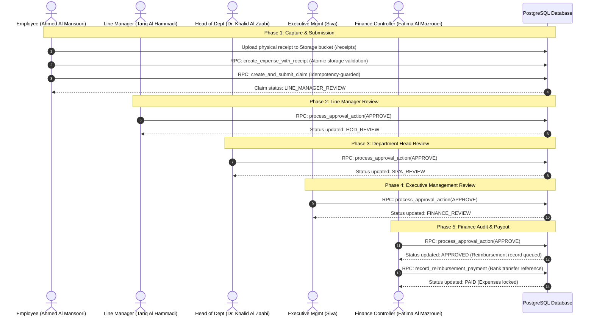
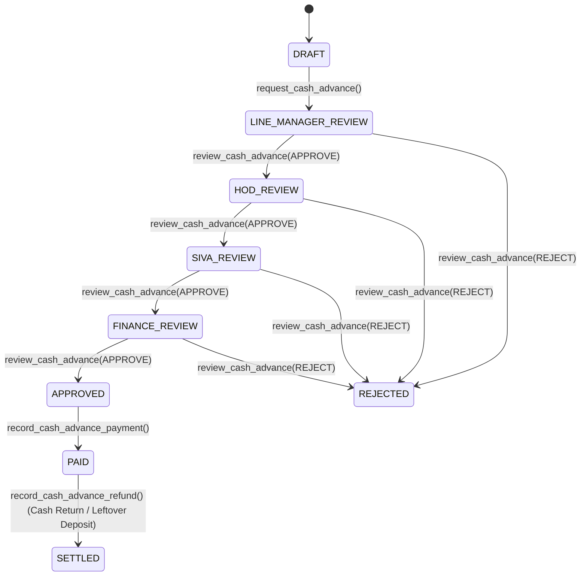

# Al Seer Marine (ASM) Expense & Reimbursement Platform

[](https://flutter.dev)
[](https://dart.dev)
[](https://supabase.com)
[](https://www.docker.com)
[]()
[]()

A private enterprise-grade financial management platform designed for **Al Seer Marine (ASM)** to streamline operational expenditures, offshore vessel fleet expenses, multi-tier corporate approvals, cash advance reconciliations, and bilingual receipt OCR data extraction.

---

## Table of Contents
1. [Executive Overview](#executive-overview)
2. [High-Level System Architecture](#high-level-system-architecture)
3. [End-to-End Business Workflows](#end-to-end-business-workflows)
   - [Claim Lifecycle & Multi-Tier Approval Chain](#1-claim-lifecycle--multi-tier-approval-chain)
   - [Cash Advance & Leftover Refund Lifecycle](#2-cash-advance--leftover-refund-lifecycle)
   - [Claim Correction & Pre-Approval Cancellation](#3-claim-correction--pre-approval-cancellation)
4. [Frozen Bilingual OCR Engine](#frozen-bilingual-ocr-engine)
5. [Enterprise Security & Financial Integrity](#enterprise-security--financial-integrity)
6. [Repository & Project Structure](#repository--project-structure)
7. [Enterprise Roles & Organizational Hierarchy](#enterprise-roles--organizational-hierarchy)
8. [Setup & Local Development Guide](#setup--local-development-guide)
9. [Release & Deployment Status](#release--deployment-status)
10. [Confidentiality & Compliance Notice](#confidentiality--compliance-notice)

---

## Executive Overview

The ASM Expense & Reimbursement Platform automates and governs corporate spending across onshore departments and offshore maritime operations. It replaces manual paper forms and unvalidated spreadsheets with:

- **Strict Financial Math:** Integer-only minor units (`fils` / cents) preventing IEEE 754 floating-point rounding discrepancies.
- **Hierarchical Approval Routing:** Dynamic multi-tier approval chains spanning Line Manager, Head of Department (HOD), Executive Management (Siva), and Finance Controller (Fatima Al Mazrouei).
- **Frozen Bilingual OCR Engine:** Server-authoritative receipt extraction processing English and Arabic tax invoices with deterministic rotation across Vision AI providers and local Tesseract fallback.
- **Direct Expense Claim Flow:** Standard employee reimbursement workflow without advance-linking requirements (`advance_applied_minor = 0`, `net_reimbursement = total_expense`).
- **Flexible Multi-Currency & Auto-Detection:** Searchable global currency catalog (GBP £, INR ₹, USD $, EUR €, AED, SAR, QAR, etc.), custom ISO-4217 currency support, and automatic receipt OCR currency preselection with authoritative server-rate conversion.
- **Standalone Cash Advance Subsystem:** Dedicated cash advance request-to-disbursement module with approval lifecycle and leftover refund handling, cleanly isolated from normal expense claims.
- **Enterprise Security:** Comprehensive PostgreSQL Row-Level Security (RLS), defensive database triggers preventing state tampering, audit trails, and client route guards.

---

## High-Level System Architecture



---

## End-to-End Business Workflows

### 1. Claim Lifecycle & Multi-Tier Approval Chain

Every claim moves through strict server-authoritative state transitions. Direct status updates (`PATCH`) from the client are forbidden and rejected by database triggers.



### 2. Standalone Cash Advance Lifecycle & Leftover Refunds

The platform maintains a dedicated, standalone Cash Advance subsystem for employees who need operational cash before travel or field refits. This module operates independently from the normal expense claim flow, preventing employees from having to reconcile or attach advances to standard reimbursement claims.



### 3. Claim Correction & Pre-Approval Cancellation

- **Approver Requests Correction:** Any approver in the chain can request corrections with mandatory notes. The claim status updates to `CORRECTION_REQUIRED`. The employee edits details and invokes `resubmit_corrected_claim()`, returning the claim directly to `LINE_MANAGER_REVIEW`.
- **Pre-Approval Cancellation:** Employees can cancel their own claims anytime prior to final approval using `cancel_expense_claim()`. The trigger `trg_claim_lifecycle_effects` automatically releases all attached expense rows and cash advance reservations.
- **Immutability After Payout:** Once approved or paid, claims cannot be cancelled or deleted.

---

## Frozen Bilingual OCR Engine

The OCR module operates under a strict **Production Freeze** with proven deterministic accuracy:

```
                          Incoming Receipt Image
                                    │
                                    ▼
                     [ next_ocr_provider_slot(3) ]
                                    │
             ┌──────────────────────┼──────────────────────┐
             ▼                      ▼                      ▼
      [ Provider 1 ]         [ Provider 2 ]         [ Provider 3 ]
       (Vision AI)            (Failover AI)          (Secondary)
             │                      │                      │
             └──────────────┬───────┴──────────────────────┘
                            │ (If all 3 cloud providers fail)
                            ▼
               [ Local Tesseract Service ]
                 (English + Arabic Trained)
                            │
                            ▼
              [ Regex Normalization Engine ]
       - Subtotal exclusion & grand total capture
       - Tax Invoice Number (TRN / Inv #) isolation
       - VAT cross-verification (Amount vs. Net x 5%)
       - DD/MM/YYYY, YYYY-MM-DD & Arabic date parsing
```

- **Validation Suite:** 35/35 Node.js test cases + 19/19 Python test cases passing (100% pass rate).
- **Multi-Currency Auto-Detection:** Automatically recognizes currency symbols and ISO codes on receipts (e.g. `£` / `GBP`, `₹` / `INR`, `€` / `EUR`, `$` / `USD`, `AED`, `SAR`, `QAR`) and preselects the corresponding currency in the expense verification form.
- **Zero Hallucination Policy:** Fields that cannot be extracted with high confidence remain `null` rather than guessing.

---

## Enterprise Security & Financial Integrity

1. **Integer Minor Units:** All monetary values are strictly stored as `BIGINT` minor units (e.g., `15000` fils = `150.00 AED`). Float arithmetic is completely prohibited in application and database logic.
2. **Defensive Database Triggers:**
   - `trg_enforce_claim_status_transition`: Enforces valid state machine progressions.
   - `trg_protect_employee_hierarchy`: Blocks non-admin users from altering line managers, departments, or role assignments.
   - `trg_claim_lifecycle_effects`: Guarantees atomic locking and releasing of linked expenses.
3. **Row-Level Security (RLS):**
   - Employees access only their own expenses, claims, and cash advances.
   - Approvers view only claims where they are designated in the hierarchical review path.
   - Finance and System Administrators have audited administrative scopes.
4. **Idempotency Safeguards:** All transactional RPCs require UUID idempotency keys to eliminate network retry duplicates.

---

## Repository & Project Structure

```
ASM-Expense-Reimbursement-Platform/
├── mobile/                               # Flutter Mobile & Web Application
│   ├── android/                          # Android Native Config & ProGuard Rules
│   │   ├── app/build.gradle.kts          # Release signing configuration
│   │   └── key.properties.example        # Keystore template for IT
│   ├── ios/                              # iOS Native Config & Xcode Project
│   │   └── Runner/Info.plist             # Camera & Photo Library permissions
│   ├── lib/
│   │   ├── app/router/                   # Enterprise Route Guards & GoRouter
│   │   ├── core/theme/                   # Al Seer Marine Corporate Design Tokens
│   │   ├── features/
│   │   │   ├── auth/                     # Authentication & kDebugMode Personas
│   │   │   ├── dashboard/                # Role-Specific Dashboard Metrics
│   │   │   ├── expenses/                 # Expense Recording & Storage Upload
│   │   │   ├── receipts/                 # Camera Scanner & OCR Verification
│   │   │   ├── claims/                   # Claim Assembly & Submission
│   │   │   ├── approvals/                # Hierarchical Approval Queues
│   │   │   ├── advances/                 # Cash Advance Lifecycle
│   │   │   ├── reimbursements/           # Finance Audit & Disbursement
│   │   │   └── reports/                  # Analytics & PDF/CSV Export
│   │   └── shared/                       # Models, Timeline & Reusable Widgets
│   └── test/                             # 114 Unit, Widget & Contract Tests
├── supabase/                             # Backend Migrations & Serverless
│   ├── functions/
│   │   └── process-receipt-ocr/          # Deno OCR Orchestrator & Normalizer
│   ├── migrations/                       # 17 Versioned SQL Database Migrations
│   │   └── CONSOLIDATED_MASTER_SETUP.sql # Consolidated Baseline Schema
│   └── tests/                            # Node.js OCR Unit & Integration Tests
├── services/
│   └── unlimited_ocr/                    # Python Tesseract Microservice
│       ├── app.py                        # FastAPI / Flask Service Endpoint
│       ├── receipt_parser.py             # Regex Parser & Field Extraction
│       └── tests/                        # 19 Python Unit Tests
├── docs/                                 # Architecture & Specification Documents
├── scripts/                              # IT Deployment & Role Setup Utilities
│   ├── provision_roles.py                # Initial Persona & Role Provisioning
│   └── rotate_shared_passwords.py        # Bulk Secure Password Rotation Utility
├── .env.example                          # Environment Variables Template
├── .gitignore                            # Secrets & Keystore Exclusion Guard
└── README.md                             # System Documentation
```

---

## Enterprise Roles & Organizational Hierarchy

| Role | Default Test Account | Name | Department | Primary Responsibilities |
| :--- | :--- | :--- | :--- | :--- |
| **Employee** | `employee@alseermarine.com` | Ahmed Al Mansoori | Marine Operations & Fleet | Scan receipts, log expenses, request advances, submit claims |
| **Line Manager** | `manager@alseermarine.com` | Tariq Al Hammadi | Marine Operations & Fleet | Tier 1 line review; request correction, approve, or reject |
| **Head of Dept (HOD)** | `hod@alseermarine.com` | Dr. Khalid Al Zaabi | Marine Operations & Fleet | Tier 2 department budget review and endorsement |
| **Management** | `management@alseermarine.com` | Siva | Executive Management | Tier 3 executive governance and threshold sign-off |
| **Finance Controller**| `finance@alseermarine.com` | Fatima Al Mazrouei | Finance & Accounting | Tier 4 financial audit, payment disbursement, advance refunds |
| **System Admin** | `admin@alseermarine.com` | Saeed Al Qubaisi | General Administration | System configuration, policy limits, audit trail review |
| **Vessel Staff** | `37317@alseermarine.com` | Meharoof KottileValappil | Marine Operations & Fleet | Operations staff member (numeric employee ID login) |

---

## Setup & Local Development Guide

### Prerequisites
- **Flutter SDK:** 3.24+ (Dart 3.5+)
- **Node.js:** 20.x+
- **Python:** 3.11+
- **Docker:** (Optional, for local OCR container)
- **Supabase CLI:** 2.x+

### 1. Environment Configuration
Copy the template and configure your project keys:
```bash
cp .env.example .env
```
*(Note: `.env` is strictly ignored by git and must never be committed).*

### 2. Running the Mobile Application
```bash
cd mobile
flutter pub get

# Run on connected device or emulator
flutter run

# Run with Web support
flutter run -d chrome
```

### 3. Running Automated Test Suites
```bash
# Mobile Unit & Widget Tests (114 tests)
cd mobile
flutter test

# Dart Static Analysis (Must return 0 issues)
flutter analyze

# Node.js OCR Parser & Orchestrator Tests (35 tests)
cd ..
node --test supabase/tests/ocr_parser.test.mts supabase/tests/ocr_orchestrator.test.mts

# Python OCR Microservice Tests (19 tests)
python -m unittest services/unlimited_ocr/tests/test_receipt_parser.py
```

---

## Release & Deployment Status

- **Code & Logic Freeze:** **ACTIVE** — No business logic or schema changes permitted.
- **Android Release:**
  - Artifacts built: `mobile/build/app/outputs/bundle/release/app-release.aab` (55.6 MB).
  - To apply corporate signing: Copy `mobile/android/key.properties.example` to `mobile/android/key.properties` and populate with the Al Seer Marine release keystore credentials.
- **iOS Release:**
  - Xcode workspace configured in `mobile/ios/Runner.xcworkspace`.
  - Privacy keys (`NSCameraUsageDescription`, `NSPhotoLibraryUsageDescription`) verified in `Info.plist`.
  - Ready for archiving on a macOS host via Xcode.
- **Production Credential Rotation:**
  - IT administrators can rotate setup passwords prior to user distribution by running:
    ```bash
    python scripts/rotate_shared_passwords.py --apply
    ```

---

## Confidentiality & Compliance Notice

This software, including all underlying source code, database schemas, and workflows, is the proprietary property of **Al Seer Marine PJSC (ASM)**. Unauthorized copying, reverse engineering, redistribution, or deployment outside authorized Al Seer Marine infrastructure is strictly prohibited.

*Copyright © 2026 Al Seer Marine PJSC. All Rights Reserved.*
