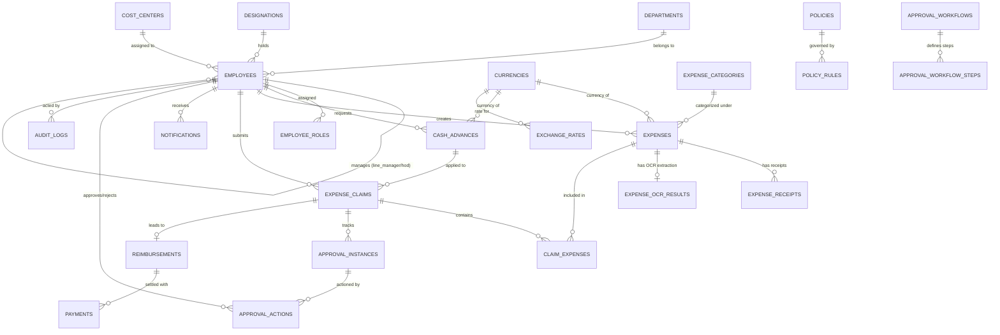

# ASM Expense Platform — Entity Relationship Diagram & Schema Specification

## 1. Domain ERD (Mermaid)

---

## 2. Table Specifications & Monetary Model

### Financial Monetary Standard
To prevent binary floating point inaccuracies, all monetary columns store **integer minor units** (e.g., 1 AED = 100 fils, represented as `BIGINT`).
- `amount_minor`: Integer minor units (e.g., `10050` = `100.50`)
- `currency_code`: ISO 4217 (e.g., `AED`, `USD`, `EUR`)
- `exchange_rate`: Stored as `NUMERIC(18, 6)`
- `aed_amount_minor`: Converted integer minor units in base AED

---

## 3. Database Entities Summary

### 3.1 Identity Domain
- **`departments`**: `id` (UUID), `code` (VARCHAR), `name` (VARCHAR), `hod_employee_id` (UUID), `is_active` (BOOL), `created_at`, `updated_at`.
- **`designations`**: `id` (UUID), `title` (VARCHAR), `grade` (VARCHAR), `is_active` (BOOL), `created_at`.
- **`cost_centers`**: `id` (UUID), `code` (VARCHAR), `name` (VARCHAR), `department_id` (UUID), `is_active` (BOOL).
- **`employees`**: `id` (UUID, maps to `auth.users.id`), `employee_code` (VARCHAR unique), `full_name` (VARCHAR), `email` (VARCHAR unique), `phone` (VARCHAR), `department_id` (UUID), `designation_id` (UUID), `line_manager_id` (UUID), `hod_id` (UUID), `cost_center_id` (UUID), `is_active` (BOOL), `joining_date` (DATE), `created_at`, `updated_at`.
- **`employee_roles`**: `id` (UUID), `employee_id` (UUID), `role` (ENUM: `EMPLOYEE`, `LINE_MANAGER`, `DEPARTMENT_MANAGER`, `MANAGEMENT`, `FINANCE`, `ADMIN`), `granted_at`, `granted_by`.

### 3.2 Configuration & Policy Domain
- **`currencies`**: `code` (CHAR(3) PK), `name` (VARCHAR), `symbol` (VARCHAR), `decimals` (INT DEFAULT 2), `is_base` (BOOL DEFAULT false), `is_active` (BOOL DEFAULT true).
- **`exchange_rates`**: `id` (UUID), `from_currency` (CHAR(3)), `to_currency` (CHAR(3)), `rate` (NUMERIC(18, 6)), `effective_date` (DATE), `source` (VARCHAR), `created_at`.
- **`expense_categories`**: `id` (UUID), `code` (VARCHAR unique), `name` (VARCHAR), `description` (TEXT), `requires_receipt` (BOOL DEFAULT true), `max_limit_minor` (BIGINT NULL), `is_active` (BOOL DEFAULT true), `created_at`.
- **`policies`**: `id` (UUID), `code` (VARCHAR unique), `title` (VARCHAR), `description` (TEXT), `is_active` (BOOL DEFAULT true), `created_at`, `updated_at`.
- **`policy_rules`**: `id` (UUID), `policy_id` (UUID), `rule_key` (VARCHAR unique), `rule_value` (JSONB), `description` (TEXT), `is_active` (BOOL DEFAULT true), `updated_at`.
- **`approval_workflows`**: `id` (UUID), `name` (VARCHAR), `description` (TEXT), `is_default` (BOOL DEFAULT false), `is_active` (BOOL DEFAULT true), `created_at`.
- **`approval_workflow_steps`**: `id` (UUID), `workflow_id` (UUID), `step_order` (INT), `step_name` (VARCHAR), `approver_type` (ENUM: `LINE_MANAGER`, `HOD`, `SPECIFIC_EMPLOYEE`, `ROLE`), `target_role` (VARCHAR NULL), `target_employee_id` (UUID NULL), `created_at`.

### 3.3 Financial & Expense Domain
- **`cash_advances`**: `id` (UUID), `advance_number` (VARCHAR unique), `employee_id` (UUID), `amount_minor` (BIGINT), `currency_code` (CHAR(3)), `aed_amount_minor` (BIGINT), `exchange_rate` (NUMERIC(18,6)), `purpose` (TEXT), `start_date` (DATE), `end_date` (DATE), `status` (ENUM: `DRAFT`, `SUBMITTED`, `UNDER_REVIEW`, `APPROVED`, `REJECTED`, `PAID`, `PARTIALLY_SETTLED`, `SETTLED`, `CANCELLED`), `approved_by` (UUID), `approved_at` (TIMESTAMPTZ), `paid_at` (TIMESTAMPTZ), `reconciled_amount_minor` (BIGINT DEFAULT 0), `created_at`, `updated_at`.
- **`expenses`**: `id` (UUID), `employee_id` (UUID), `category_id` (UUID), `amount_minor` (BIGINT), `currency_code` (CHAR(3)), `exchange_rate` (NUMERIC(18,6)), `aed_amount_minor` (BIGINT), `expense_date` (DATE), `vendor` (VARCHAR), `invoice_number` (VARCHAR NULL), `tax_amount_minor` (BIGINT DEFAULT 0), `description` (TEXT), `has_receipt` (BOOL), `no_receipt_reason` (TEXT NULL), `is_locked` (BOOL DEFAULT false), `created_at`, `updated_at`.
- **`expense_receipts`**: `id` (UUID), `expense_id` (UUID), `storage_path` (VARCHAR), `original_file_name` (VARCHAR), `file_size_bytes` (INT), `mime_type` (VARCHAR), `uploaded_by` (UUID), `uploaded_at` (TIMESTAMPTZ).
- **`expense_ocr_results`**: `id` (UUID), `expense_id` (UUID), `receipt_id` (UUID), `raw_ocr_response` (JSONB), `extracted_vendor` (VARCHAR), `extracted_invoice_number` (VARCHAR), `extracted_date` (DATE), `extracted_total_minor` (BIGINT), `extracted_tax_minor` (BIGINT), `extracted_currency` (CHAR(3)), `is_verified_by_user` (BOOL DEFAULT false), `created_at`.
- **`expense_claims`**: `id` (UUID), `claim_number` (VARCHAR unique), `employee_id` (UUID), `title` (VARCHAR), `purpose` (TEXT), `claim_date` (DATE), `cash_advance_id` (UUID NULL), `advance_applied_minor` (BIGINT DEFAULT 0), `total_expense_minor` (BIGINT DEFAULT 0), `net_reimbursement_minor` (BIGINT DEFAULT 0), `status` (ENUM: `DRAFT`, `SUBMITTED`, `LINE_MANAGER_REVIEW`, `HOD_REVIEW`, `SIVA_REVIEW`, `FINANCE_REVIEW`, `APPROVED`, `REIMBURSEMENT_PROCESSING`, `PAID`, `SETTLED`, `REJECTED`, `CORRECTION_REQUIRED`, `CANCELLED`), `validation_status` (VARCHAR DEFAULT 'PENDING'), `validation_notes` (TEXT), `submitted_at` (TIMESTAMPTZ), `approved_at` (TIMESTAMPTZ), `created_at`, `updated_at`.
- **`claim_expenses`**: `id` (UUID), `claim_id` (UUID), `expense_id` (UUID), `added_at` (TIMESTAMPTZ), UNIQUE(`claim_id`, `expense_id`).
- **`reimbursements`**: `id` (UUID), `claim_id` (UUID unique), `employee_id` (UUID), `amount_minor` (BIGINT), `currency_code` (CHAR(3)), `aed_amount_minor` (BIGINT), `status` (ENUM: `PENDING`, `PROCESSING`, `PAID`, `CANCELLED`), `processed_by` (UUID), `created_at`, `updated_at`.
- **`payments`**: `id` (UUID), `reimbursement_id` (UUID), `payment_reference` (VARCHAR unique), `idempotency_key` (VARCHAR unique), `payment_method` (VARCHAR), `paid_amount_minor` (BIGINT), `payment_date` (DATE), `recorded_by` (UUID), `notes` (TEXT), `created_at`.

### 3.4 Workflow & Governance Domain
- **`approval_instances`**: `id` (UUID), `claim_id` (UUID), `current_step_order` (INT), `current_approver_id` (UUID NULL), `current_approver_role` (VARCHAR NULL), `status` (VARCHAR), `started_at` (TIMESTAMPTZ), `completed_at` (TIMESTAMPTZ).
- **`approval_actions`**: `id` (UUID), `approval_instance_id` (UUID), `claim_id` (UUID), `step_order` (INT), `actor_id` (UUID), `action` (ENUM: `APPROVE`, `REJECT`, `REQUEST_CORRECTION`, `FORWARD`), `previous_status` (VARCHAR), `new_status` (VARCHAR), `comments` (TEXT), `action_timestamp` (TIMESTAMPTZ DEFAULT now()).
- **`notifications`**: `id` (UUID), `recipient_id` (UUID), `title` (VARCHAR), `body` (TEXT), `event_type` (VARCHAR), `entity_type` (VARCHAR), `entity_id` (UUID), `is_read` (BOOL DEFAULT false), `created_at`.
- **`audit_logs`**: `id` (UUID), `actor_user_id` (UUID NULL), `actor_role` (VARCHAR NULL), `action` (VARCHAR), `entity_type` (VARCHAR), `entity_id` (UUID), `old_values` (JSONB NULL), `new_values` (JSONB NULL), `ip_address` (VARCHAR NULL), `created_at` (TIMESTAMPTZ DEFAULT now()).
